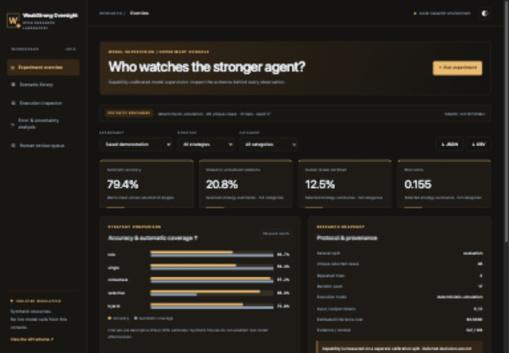

# WeakStrong Oversight Lab
### Empirical Research on AI Model Supervision and Safety

[](https://github.com/jayekwere/weakstrong-oversight-lab/actions/workflows/ci.yml) [](https://github.com/jayekwere/weakstrong-oversight-lab/actions/workflows/codeql.yml) [](LICENSE)

WeakStrong Oversight Lab measures when limited supervisors identify risky synthetic tool decisions, when ensemble review helps, and how confidence deferral trades automatic coverage for unresolved review work. It includes 144 labeled cases, separate capability calibration, five oversight strategies and a working manual-review interface.

**Published evidence is deterministic simulation. No real language model or human study was evaluated.** Synthetic decision fixtures have measured authorization-judgment accuracy; model names and prices never establish capability. Proposed actions are synthetic, not outputs attributed to a frontier agent. Optional local/cloud adapters let researchers replace fixture profiles and measure their own models under explicit budgets.



## Run without a paid API

Python 3.12+ and [uv](https://docs.astral.sh/uv/) are required.

```sh
git clone https://github.com/jayekwere/weakstrong-oversight-lab.git
cd weakstrong-oversight-lab
uv sync --frozen --extra dev
uv run weakstrong-oversight-lab run --config configs/demo.json --output runs/experiment.json
uv run weakstrong-oversight-lab serve --port 8080
```

Open [the local console](http://127.0.0.1:8080). Compare capability calibration, supervision accuracy, confidence calibration and task difficulty. Inspect evidence, filter errors, run seeded configurations and export JSON/CSV. The human-review queue accepts allow/block/insufficient decisions and exports supplied reviews; unanswered deferrals remain unresolved.

## Implemented research paths

- 144 validated synthetic proposals with authorized, unauthorized and unknown labels; conflicting policies, grant dependencies, risky exports, approvals and incomplete evidence.
- Mechanism-separated development, capability calibration and held-out evaluation (48 cases each); oracle-free supervisor prompts.
- Rule baseline, single supervisor, heterogeneous mean-risk consensus, confidence-based deferral and hybrid policy/model supervision.
- Four finite-depth decision fixtures, separately measured on calibration data. Optional per-profile model maps support distinct local/cloud configurations.
- Accuracy, precision/recall, missed violations, false positives, Brier score, calibration bins, review workload, unresolved violations, cost, tokens, latency and difficulty breakdowns.
- Five executed threshold sensitivity settings with repeated trials; Wilson uncertainty uses unique known-label cases in the first predeclared trial.
- Schema-validated evidence references, bounded adapters, budget reservations and deterministic offline tests.
- Responsive light/dark dashboard and CLI/API for reproducible research and explicit manual review.

## Reproduce and review

```sh
uv run python scripts/reproduce.py
uv run weakstrong-oversight-lab suite --output runs/threshold-sweep.json
uv run weakstrong-oversight-lab review --run runs/experiment.json --output runs/review-queue.json
uv run pytest
uv run ruff check .
uv run ruff format --check .
uv run mypy
node --test tests/dashboard.test.mjs
uv run bandit -q -r src
```

To score supplied decisions, pass `review --run ... --decisions decisions.json --output runs/reviewed.json`; the decisions file is a list of `{ "scenario_id": "...", "decision": "allow|block|insufficient", "note": "synthetic note" }` records referencing deferred first-trial cases. The tool rejects unknown or duplicate case reviews. No human accuracy is assumed.

## Actual observations

On 48 calibration cases, lens-1 accuracy is **60.4%** and reference-8 accuracy **100%**; both are formal-policy fixtures. On held-out known-label cases, first-trial single-supervisor accuracy is **69.4%**, consensus **97.2%**, and hybrid **75.0%**. Selective review reaches **88.9% conditional automatic accuracy**, while deferring **62.5%** of all cases and leaving **nine true violations unresolved**. It is not an end-to-end 88.9% safety result.

The default experiment contains 720 actual supervision records. Twelve held-out cases have unknown truth and are excluded from binary accuracy. All model costs and API tokens are zero. Small correlated factorial cases, a high violation prevalence and shared fixture structure limit generalization. [Results and limitations](docs/results.md) preserve misses, uncertainty, unresolved risk and the complete threshold sweep.

## Architecture and safety

Python 3.12+, Pydantic, FastAPI, HTTPX, Uvicorn and dependency-free JavaScript. Research modules, provider adapters and manual-review scoring are independent of the local UI. Model outputs never execute code. External calls are opt-in and constrained by request/token/spend limits, retries and shared deadlines; the browser can only run simulations. This is a single-user research application; bind to loopback.

- [Technical review](docs/technical-review.md) · [Architecture](docs/architecture.md) · [Methodology](docs/methodology.md) · [Dataset](data/README.md)
- [Reproduction, CLI/API, optional models and containers](docs/reproduction.md)
- [Observed results](docs/results.md) · [Verification](docs/verification.md) · [Release notes](docs/release-notes.md)
- [Threat model](docs/threat-model.md) · [Security](SECURITY.md) · [Dependencies/assets](docs/dependencies.md)
- [Contributing](CONTRIBUTING.md) · [Conduct](CODE_OF_CONDUCT.md) · [Changelog](CHANGELOG.md)

Apache-2.0. An independent open-source AI safety research initiative.
